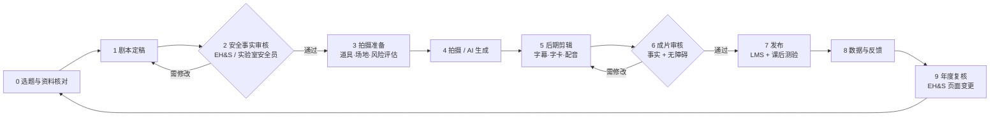

# 安全教学视频制作工作流

本文说明如何把 `ep01`–`ep06` 的剧本做成可发布的教学视频，以及之后如何持续更新。流程同时适用于实拍和 AI 辅助制作。

## 总览

## 角色

| 角色 | 职责 |
|---|---|
| 项目负责人 | 排期、预算、最终发布决定 |
| 内容专家（实验室安全员 / EH&S） | 剧本和成片的**安全事实审核**，对每个数字签字确认 |
| 编导 | 剧本定稿、分镜、现场指导 |
| 摄制 / 剪辑 | 拍摄、剪辑、字幕、调色 |
| 现场安全监督 | 拍摄风险评估、道具检查、清场 |
| 演员 | 真实研究生或教师出镜效果更好 |

## 0 选题与资料核对（第 1 周）

1. 对照 `../../zh/` 和 `../../en/` 中的出处页面，确认剧本中的数字和规定仍然有效。EH&S 网站会更新，以页面上的"最后更新"日期为准。
2. 如果在其他高校使用：把电话、机构名称、委员会名称和系统名称（My Research Safety、OTP、WGN 等）替换成本校对应的名称。
3. 输出：一份"事实清单"，逐条列出剧本中出现的每个数字、时限和电话及其出处。

## 1 剧本定稿（第 1–2 周）

- 每集控制在 3–5 分钟，只讲 3 个要点，结尾用一句话回顾。
- 每个镜头写清楚画面、旁白、屏幕文字和时长（参见各集剧本的表格格式）。
- 反面示范镜头必须标注"✗"，正面示范标注"✓"，避免观众模仿错误做法。

## 2 安全事实审核（关卡）

- 内容专家逐条核对"事实清单"，在剧本上签字并注明日期。
- 检查拍摄方案本身是否安全，例如是否需要真实危险品（答案应当是不需要）。
- **未通过审核不得进入拍摄。**

## 3 拍摄准备（第 3 周）

| 项目 | 要求 |
|---|---|
| 道具 | 一律用清空清洗后的空瓶 + 道具标签；液体用清水、食用色素或明胶 |
| 危险场景 | 火焰、气体、爆炸、气溶胶一律用动画或后期特效；如需实拍火焰，须在消防部门监督下使用训练装置 |
| 场地 | 提前与实验室 PI 预约；拍摄期间暂停该区域实验，清场 |
| 着装 | 出镜人员按规定着装（正面示范镜头），反面镜头单独拍摄 |
| 隐私 | 屏幕录制使用测试账号；对门牌、姓名、电话之外的个人信息打码 |
| 风险评估 | 现场安全监督填写拍摄风险评估表并签字 |

## 4 拍摄 / 生成（第 3–4 周）

**方案 A：实拍**（推荐用于操作演示）
- 1 天拍 2 集；先拍全景和空镜，再拍特写。
- 操作类镜头（BSC、洗眼器、PASS）多拍几条，留给剪辑挑选。

**方案 B：AI 辅助**（适合动画、字卡和多语种版本）
- 动画和字卡：用剧本中的"屏幕文字"列直接生成动态图形。
- 配音：TTS 生成普通话和英文两版旁白。上线前须人工试听，检查专业术语读音（如 BSL、HEPA、PASS）。
- AI 生成的视频画面**不得**用于演示操作细节，因为模型可能画错手部动作、标签或设备；操作镜头一律实拍。
- 所有 AI 生成的素材都要经过第 6 步的事实审核。

## 5 后期（第 4–5 周）

- 字幕：中英双语，与旁白同步；关键数字加粗或放大。
- 片头 5 秒内出现标题，片尾 10 秒放回顾和课后测验二维码（链接到 `../question-bank/` 中对应模块）。
- 音乐音量不要盖过旁白；警示镜头可以配提示音。
- 导出：1080p MP4 + 带烧录字幕版 + 无字幕版（供翻译）。

## 6 成片审核（关卡）

- 内容专家看完整片，再次核对数字和画面中的标签、标识。
- 无障碍：字幕准确，色彩对比足够，不依赖颜色单独传达信息（"✓/✗"同时配文字）。
- 找 3–5 名目标观众试看，确认能答对对应的课后测验题。

## 7 发布

- 上传到学校的 LMS 或视频平台，与课件和题库绑定。
- 设置"看完视频 → 完成对应测验 → 记录成绩"的学习路径。
- 培训记录至少保存 3 年。

## 8 数据与反馈

- 每月查看完播率和测验正确率。
- 某题正确率低于 70% 时，回看对应镜头，判断是否需要重剪或补拍。

## 9 年度复核

- 每年（或 EH&S 页面更新时）重新执行第 0 步。
- 规定变化时只重做受影响的镜头和字卡，并在视频说明中注明版本号和日期，例如 `EP04 v1.1（2027-03 更新下水道限值）`。

## 排期示例（6 集）

| 周 | 工作 |
|---|---|
| 1 | 资料核对、事实清单 |
| 2 | 剧本定稿、安全审核 |
| 3 | 拍摄准备、EP01–EP03 拍摄 |
| 4 | EP04–EP06 拍摄、AI 动画与配音 |
| 5 | 剪辑、字幕 |
| 6 | 成片审核、试看、发布 |

## 检查清单

- [ ] 事实清单已由内容专家签字
- [ ] 拍摄风险评估已签字
- [ ] 无真实危险品出镜
- [ ] 反面示范已标注"✗"
- [ ] 本校电话和机构名称已替换
- [ ] 中英字幕已校对
- [ ] 课后测验二维码可用
- [ ] 版本号和日期已写入视频说明
